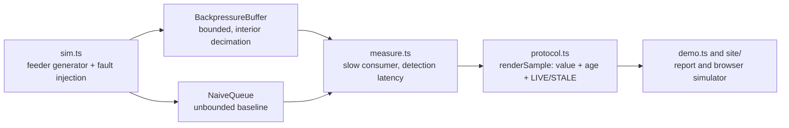

# gridboard

A backpressure-aware telemetry buffer for grid dispatch consoles: under overload it degrades visibly and keeps the newest sample, instead of silently showing stale data.

[](https://github.com/SlateGitOrg/gridboard/actions/workflows/ci.yml)
[Live simulator](https://slategitorg.github.io/gridboard/)


## Why

Grid controllers watch thousands of telemetry points and must act within seconds. If the console lags, or renders an old value as though it were live, an operator makes a dispatch decision on fiction. Most real-time dashboards work in a demo and fall apart when the data rate exceeds what the client can consume, usually by queueing an ever-growing backlog. Gridboard implements the alternative and measures the difference.

## Features

- **Bounded buffer with interior decimation.** When full, it drops every second sample between the oldest and newest. The newest sample is never dropped and the oldest stays as a continuity anchor.
- **Per-feeder sequence numbers.** Gaps from downsampling are legal and detectable (`gapSince`).
- **Staleness as a rendered state.** `renderSample` always attaches the value's age and a `LIVE` or `STALE` state (default threshold 2 s).
- **Seeded fault simulator.** Deterministic feeder streams with injected voltage-sag, flatline and clock-skew faults, each with a known feeder and onset tick.
- **Measurement harness.** Drives a bounded buffer and an unbounded queue through the same slow consumer and reports detection latency against the true fault onset.
- **Browser simulator.** `site/` is a static page that models naive versus downsampled delivery for a chosen burst, published to GitHub Pages.

## Architecture



The simulator emits interleaved samples. The measurement harness pushes them into a buffer while a consumer drains one sample per N pushes (a 10x overload by default), and records how long after each fault's true onset the consumer first sees it. See [docs/ARCHITECTURE.md](docs/ARCHITECTURE.md).

## Quick start

Requires Node 22.18+ (24 recommended). TypeScript runs through Node's built-in type stripping, so there is no build step and no dependencies to install.

```bash
git clone https://github.com/SlateGitOrg/gridboard.git
cd gridboard
npm test        # 16 tests
npm run demo    # bounded buffer vs unbounded queue under 10x overload
```

To try the browser simulator locally, serve `site/` with any static server, for example `python3 -m http.server -d site 8000`.

## Example

`npm run demo` runs 10 feeders for 2,000 ticks at 100 ms with four injected faults, and a consumer that drains 1 sample per 10 produced:

```text
  strategy                   detected  median     p95        peak queue  verdict
  ------------------------------------------------------------------------------
  backpressure (bounded)     4/4      1600ms     3400ms     64         PASS
  unbounded queue            0/4      never      never      18001      MISSED

  Staleness is rendered, not hidden: F0003 value=188 age=9000ms state=STALE
```

The budget is the fault duration (4,000 ms): a fault seen after it ends is history. The bounded buffer detects all four faults with a p95 inside the budget, while the unbounded queue backs up 18,001 samples and never reaches any fault within the run.

## How it works

- `BackpressureBuffer` holds at most `capacity` samples (minimum 2). On overflow it keeps the endpoints and the even-indexed interior samples, roughly halving occupancy, so a slow consumer converges on the live edge rather than drifting further behind.
- Detection latency is measured against the live edge's timestamp, not the timestamp of the sample being read. That difference is the consumer's lag, which an unbounded queue hides.
- The simulator uses a seeded PRNG (mulberry32), so every run is reproducible.

## Testing

`npm test` runs `node --test` over `tests/` and `site/`. It covers:

- the invariant that `newest()` is always the most recent push at any overload, boundedness, ordering after decimation, oldest-sample anchoring, and convergence to the live edge;
- `renderSample` staleness thresholds and that every rendered value carries an age;
- end-to-end detection under 10x overload: all faults found, p95 inside the budget, the unbounded queue measurably worse, and zero live-edge violations;
- the browser simulator's computation.

CI also validates the static site and deploys it to GitHub Pages.

## Project layout

```text
src/        protocol, backpressure buffer, simulator, measurement harness, demo
tests/      buffer, protocol and latency tests
site/       static browser simulator (published to Pages)
docs/       architecture notes and screenshots
scripts/    site validation
```

## Limitations

This is a simulation of the buffering and staleness logic. There is no network gateway, database or production UI, and the simulator models voltage faults on synthetic feeders. It is a read-and-decide design, not a control system.

## License

MIT — see [LICENSE](LICENSE).
