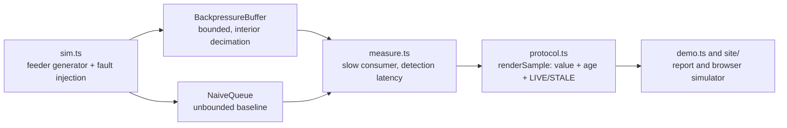

# Architecture

## Context

Grid controllers watch thousands of telemetry points and act within seconds. A console that lags, or that renders an old value as though it were live, leads to dispatch decisions made on stale data. Most real-time dashboards behave well at demo data rates and degrade silently once the feed outpaces what a client can consume. Gridboard is built around making that degradation bounded and visible.

## Container view

## Key decisions

**Bounded buffer that decimates the interior.** A slow consumer gets a fixed-capacity buffer. When it overflows, every second sample strictly between the oldest and newest is dropped. The oldest sample is kept as a continuity anchor and the newest is never dropped, so the consumer catches up to the live edge by losing resolution instead of currency. The alternative, an unbounded queue, preserves every point but lets lag grow without limit.

**Sequence numbers with legal gaps.** Each sample carries a per-feeder monotonic `seq`. Decimation creates gaps, and `gapSince` lets a consumer tell "I was skipped" from "nothing happened".

**Age travels with the value.** `renderSample` is the only way to turn a `Sample` into something displayable, and it always attaches `ageMs` and a `LIVE`/`STALE` state (default threshold 2 s).

**Ground-truth faults.** The simulator is seeded and every injected fault has a known feeder and start tick, so detection latency is measured against the true onset.

## Failure modes

- Consumer slower than the feed: the buffer stays at or below capacity and the newest sample is always available; resolution drops.
- Data older than the threshold: the panel renders `STALE` with its age.
- Capacity below 2: rejected at construction, since oldest and newest could not both be preserved.

## Out of scope

This repository contains the buffer, protocol, simulator and measurement harness plus a browser calculator. It has no network gateway, database or UI framework, and it is read-and-decide, not control.
